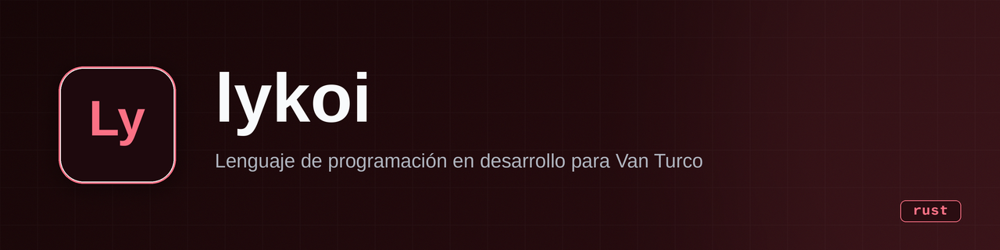

<p align="center">
  
</p>

<h1 align="center">lykoi</h1>

<p align="center"><b>An interpreted toy programming language written in Rust, built as a learning project on how compilers and interpreters work.</b></p>

<p align="center">
  
  
  
  
</p>

---

## What it is

lykoi is a small dynamically typed programming language with a tree-walking interpreter, written from
scratch in Rust (no dependencies — even `llvm-sys` is commented out in `Cargo.toml`). The source
program is currently hard-coded in `src/compiler.rs` (`get_types()`); the pipeline tokenizes it,
groups characters into words/numbers/operators, parses it into an AST following the grammar in
[`EBNF.md`](EBNF.md), and evaluates it.

What works today (verified by running `cargo run`):

- Variable assignment and lookup on a flat stack of variables: `a = 10`
- Integer arithmetic (`+ - * /`) and comparisons (`== > < >= <=`), with operator precedence
  (`*`/`/` bind tighter than `+`/`-`)
- Booleans and logic (`and`, `or`, `not`), plus `none` and string literals
- `if` / `elif` / `else` blocks
- A bare `variable` statement prints `name = value`

Example of the kind of program it evaluates (the current built-in test):

```
a = 10
if a + 2 == 15 { b = 30 } else { b = 20 }
b        # prints: b = 20
```

**In one sentence:** a hand-written tokenizer → parser → tree-walking interpreter pipeline in Rust
that can evaluate assignments, integer/boolean expressions and if/else branches.

## State

| | |
|---|---|
| **State** | experiment (paused) |
| **Last activity** | 2025-10 (code) — see notes below |
| **Usable today?** | No. It only evaluates one hard-coded snippet; there is no REPL, no file input, no CLI |
| **Missing** | Loops (`while`/`for` parse but the interpreter ignores them), user input/REPL, functions, LLVM IR codegen, the `in` operator, string operations |
| **Known debt** | Heavy debug output (`dbg!` calls print token dumps on every run), panics instead of proper error messages, 143 compiler warnings, no tests |

## Why it exists

It is a compiler/interpreter learning project, part of the toolchain the author plans for
*Van Turco* (a personal OS project; `TODO.md` mentions generating LLVM IR and a stdlib called
*Libarbys* for that OS). The name follows the cat-breed naming scheme of the author's projects:
the lykoi, like the Turkish Van, is a cat breed.

## Installation and usage

Requirements: Rust (any recent stable toolchain; no external crates, so `Cargo.lock` has no
dependencies).

```bash
git clone https://github.com/Gonanf/lykoi.git
cd lykoi
cargo build
cargo run   # tokenizes, parses and evaluates the snippet hard-coded in src/compiler.rs
```

To try different code, edit the `buffer` string in `src/compiler.rs::get_types()` — stdin input
exists but is commented out.

## Stack

- **Language / runtime:** Rust (edition 2021), no runtime beyond the binary itself
- **Dependencies:** none (LLVM bindings were tested and intentionally commented out for now)
- **What it deliberately does NOT use (yet):** a parser-combinator/LLVM toolchain — the tokenizer,
  parser and interpreter are all hand-written

## Architecture

```
tokenizer::token      single characters  → token enum
tokenizer::names      tokens             → words, numbers, literals, operators (with line/col)
parser::AST_parser    names              → AST (node / node_type), follows EBNF.md
interpreter           AST                → evaluates blocks, statements and expressions
codegen               AST                → (stubbed) future LLVM IR generation
```

Nodes are defined in `src/nodes/` (`types.rs` holds the `node_type` / `statement` / `expresions`
enums plus operator precedence tables; `implementations.rs` the keyword/operator matching).

## Repo structure

```
src/
  main.rs               entry point: chains the four pipeline stages
  compiler.rs           pipeline glue; hard-coded test program lives here
  compiler/tokenizer.rs character → token → word grouping
  compiler/parser.rs    recursive-descent parser building the AST
  compiler/interpreter.rs  tree-walking evaluator
  compiler/codegen.rs   empty stubs for future IR generation
  compiler/AST.rs       older WIP file, currently unused
  nodes/                AST node definitions and operator tables
EBNF.md                 the language grammar
TODO.md                 author's own roadmap
```

## Roadmap

From the repo's own `TODO.md` and the code:

- [ ] Interpret `while` and `for` (currently parsed, never executed)
- [ ] Read source from stdin or a file instead of the hard-coded buffer
- [ ] LLVM IR code generation (`codegen.rs` is stubbed; `llvm-sys` commented out)
- [x] Tokenizer, parser and tree-walking interpreter for expressions, assignments and if/elif/else
- [x] Operator precedence for arithmetic (added 2025-10)

## Notes and decisions

- **No license.** The repository has no LICENSE file, so the code is visible but not legally
  open source.
- **No CLI or REPL yet** — `main.rs` runs one fixed pipeline with a hard-coded program, and the
  `stdin()` read is commented out ("DEBUG ONLY"), which is the main reason this cannot be used
  as a real language today.
- The parser is recursive-descent over a reversed token vector, and `clone()`s freely;
  that's fine at this scale but it is the first thing to revisit if the language grows.
- `codegen.rs` contains empty match arms: the LLVM path was started and paused, not abandoned in
  design (it stays in the author's `TODO.md`).
- Work happened in two bursts: December 2024 (v0.0.1 → v0.0.9) and October 2025 (operator
  precedence + one merged PR), then stalled.

## License

None. All rights reserved by the author until a LICENSE file is added.

---

*Documentation generated 2026-09-21 from a read-only clone; the repo was not modified.*
